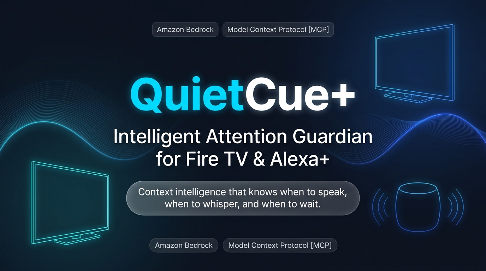

<p align="center">
  
</p>

# QuietCue+ : Intelligent Attention Guardian for Connected Displays

> **"Context intelligence that knows when to speak, when to whisper, and when to wait."**

QuietCue+ is an intelligent attention guardian engineered for Fire TV and Alexa+, powered by Amazon Bedrock and the open Model Context Protocol [MCP].

---

## Key Highlights & Innovations

1. Subtitle-Slot Whisper Delivery:
   - Non-critical notifications glide directly into the closed-caption subtitle channel during dialogue pauses, eliminating intrusive popups.

2. Dynamic Lifestyle Attention Policies:
   - Mode-based policy enforcement across Feature Night, Sports Live, Family Time, Focus Work, and VR Immersion.
   - QuietCue+ respects active immersion and holds routine alerts until scheduled session breaks.

3. Dual-Tier Breakthrough Security:
   - When life safety or perimeter alerts fire [front door camera, security sensors], QuietCue+ instantly surfaces an audible dual-tone chime and high-contrast Fire TV HUD banner.

4. Lifestyle & Routine Care:
   - Supports everyday wellness by gently surfacing hydration reminders, posture resets, and family celebration notices [such as Family Celebration days and birthdays] during session breaks.

5. Amazon Bedrock & Alexa+ Integration:
   - Natural language rule synthesis via Alexa+ powered by Anthropic Claude 3.5 Sonnet on Amazon Bedrock.
   - Decomposes spoken user goals into deterministic, schema-validated JSON policy updates.

6. Model Context Protocol [MCP] Server:
   - Self-hosted MCP server running over Streamable HTTP, adhering to the 2025-11-25 specification.
   - Exposes six deterministic tools for state inspection, alert simulation, and display synchronization.

---

## System Architecture

```text
+-----------------------------------------------------------+
|               Household Smart Devices & Sensors           |
|  [Security Cameras | Parcel Sensors | Thermostat | Cal]   |
+-----------------------------+-----------------------------+
                              |
                              v
+-----------------------------------------------------------+
|              QuietCue+ MCP Server [Port 3001]              |
|        - Implements MCP Specification 2025-11-25          |
|        - Streamable HTTP Transport & Event Engine         |
+-----------------------------+-----------------------------+
                              |
       +----------------------+----------------------+
       |                                             |
       v                                             v
+-----------------------------+     +-------------------------------+
|   Amazon Bedrock & Alexa+   |     |   Real-Time Telemetry Bus     |
|   - Claude 3.5 Sonnet       |     |   - Server-Sent Events [SSE]  |
|   - Zero-Shot Rule Compiler |     |   - Web Audio Sound Cues      |
+-----------------------------+     +---------------+---------------+
                                                    |
       +--------------------------------------------+
       |
       v
+-----------------------------------------------------------+
|               Fire TV & Companion Displays                |
|  - Fire TV Fullscreen Client [Port 5173/?client=tv]       |
|  - Companion Command Console [Port 5173]                  |
|  - Subtitle-Slot Whisper Alerts & Critical HUD Banners     |
|  - Three Immersion Themes: Slate, Warm Dusk, Daylight     |
+-----------------------------------------------------------+
```

---

## Quickstart & Local Evaluation

### Prerequisites
1. Node.js v18 or v20.
2. npm package manager.

### Setup & Installation
```bash
git clone https://github.com/sheetaal2026-cpu/QuietCuePlus.git
cd QuietCuePlus
npm install
cd backend && npm install
cd ../frontend && npm install
cd ..
```

### Launch Development Server
```bash
npm start
```
- Express Backend & MCP Server: `http://localhost:3001`
- Frontend Command Console: `http://localhost:5173`
- Fire TV Dedicated Client: `http://localhost:5173/?client=tv`

---

## MCP Toolset Implemented

QuietCue+ exposes six tools over standard Streamable HTTP:

| Tool Name | Description |
| :--- | :--- |
| `quietcue_get_state` | Returns active contracts, notifications, timer state, and display modes. |
| `quietcue_simulate_event` | Injects synthetic IoT alerts across security, parcel, calendar, and health. |
| `quietcue_update_rule` | Reconfigures category policies across interrupt now, next break, and digest. |
| `quietcue_set_mode` | Switches active television modes and synchronized stream presets. |
| `quietcue_trigger_break` | Releases queued notifications to the television screen during breaks. |
| `quietcue_end_session` | Concludes active session and compiles the End-of-Session Summary Digest. |

---

## Testing & Verification

```bash
cd backend
npx tsx test-contracts.ts
npx tsx test-engine.ts
```

Frontend production compilation:
```bash
cd frontend
npm run build
```

---

## Repository & Open Source

- Project Repository: `https://github.com/sheetaal2026-cpu/QuietCuePlus`
- Contribution URL: `https://github.com/sheetaal2026-cpu/QuietCuePlus/tree/main/backend/src/mcp`
- License: MIT Open Source License
